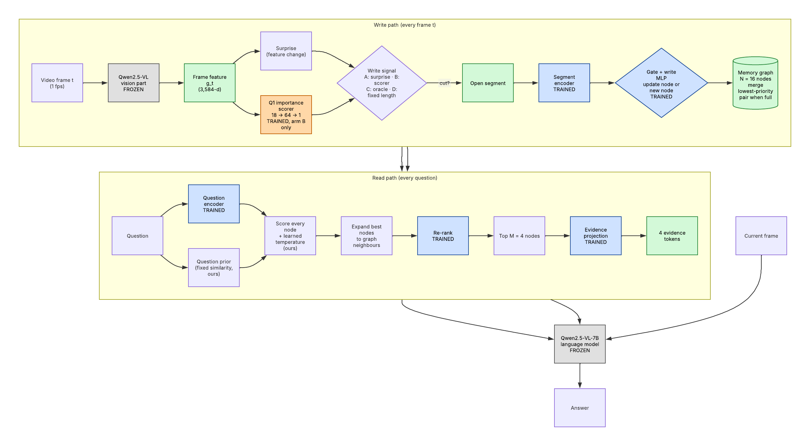
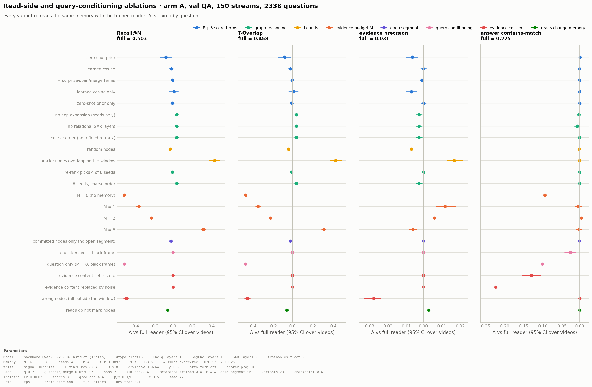
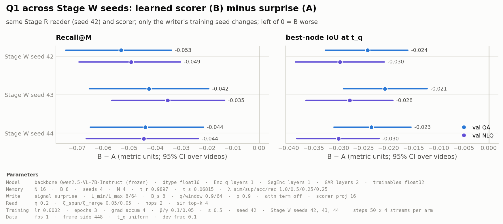
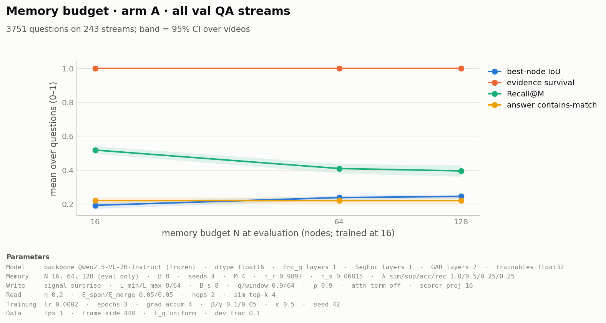
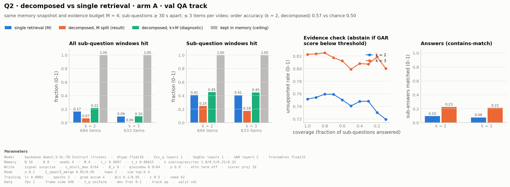
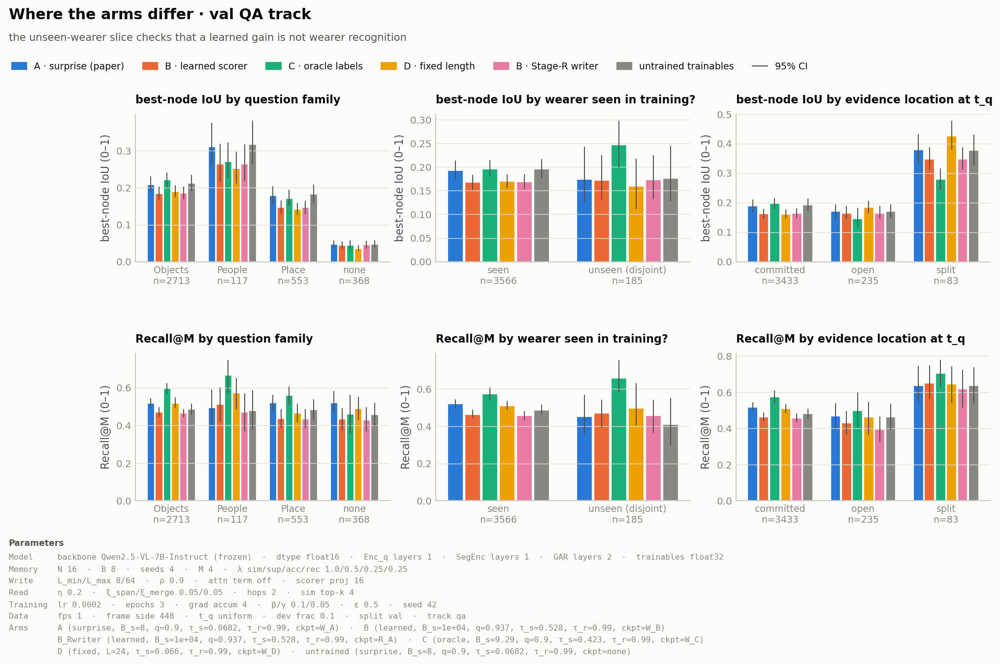

# What to Remember from a Long Video? SelectStream-lite on Ego4D NLQ and QaEgo4D

Team LMAAA: Amritha Vinod (2023101075), Dedeepya (2023101128), Keerthana Korlapati (2023101121), Sanjana Sheela (2023102027)

Code: <https://github.com/amrithav27/selectstream-lite> · Checkpoints and outputs: <https://huggingface.co/lma-project/selectstream-lite-ego4d>

Markdown copy of `docs/report_overleaf/report.tex`; the PDF is built from that file.

## Abstract

A streaming video memory of fixed size has to decide what to keep before it knows what will be asked. We rebuilt
SelectStream [1], which keeps a small graph of memory nodes and answers with a frozen Qwen2.5-VL-7B, and
ran it strictly in time order on every annotated clip of Ego4D NLQ and QaEgo4D. We asked two questions. Can an importance
score learned from past questions decide what to keep better than SelectStream's surprise signal (Q1)? Does splitting a
question about several moments into sub-questions help retrieval when the evidence budget stays the same (Q2)? Both answers
are no. The learned score keeps and retrieves the answer moment less often than surprise, on three training seeds and two
question sets. Splitting a question only helps when each part is given extra evidence, so the gain comes from the larger
budget, not from the split. Along the way we found that the frozen model's answers do not change with which moment it is
shown, so memories have to be compared by what they retrieve, not by the answers they lead to.

## Introduction

A wearable camera running all day produces hours of video, but a model can hold only a small, fixed amount
of it. The memory has to decide what to keep while the video is still arriving, before anyone has asked a
question. If the moment a later question needs has been dropped, or blurred into a neighbouring memory,
no later step can bring it back.

SelectStream [1] makes this decision with one number per moment, its surprise: how much the
scene just changed. Surprising moments get their own memory slot and are protected from merging. Surprise and
importance are not the same thing, though. A sudden turn of the head is surprising but rarely asked
about; putting keys in a drawer is calm, and is exactly what someone asks about later. This gap is what motivates our two
questions.

- **Q1 (write side).** With the same memory size and the same number of stored segments, does a write signal learned from training questions keep more of the needed evidence than surprise? We hold size and segment count fixed so that a learned signal can only win by choosing *better*, not by storing *more*.
- **Q2 (read side).** Questions often ask about two or three moments at once. Does splitting such a question into sub-questions, each with its own retrieval and evidence check, beat one retrieval when the total evidence budget is the same? Fixing the budget separates the effect of splitting from the effect of simply reading more.
Q1 changes only how the memory is written and Q2 only how it is read, so the two can be studied independently.

We found that neither idea helps in our setting, and that answer accuracy cannot tell two memories apart with a frozen
backbone. Our contributions are a causal rebuild of SelectStream with the retrieval changes it needed to learn at all, a
negative result for Q1 that holds across seeds, a negative result for Q2 with a control that explains it, and a set of
evidence controls that show which metrics can and cannot be trusted for this kind of memory.

## Literature Review

**Streaming video memory.** SelectStream [1] has four stages: surprise-driven windowing (when to write),
a latent memory graph (what to keep), graph-attention reasoning (how to read) and latent evidence injection into a frozen
model. StreamMem [5], InfiniPot-V [6] and CoRDS [7] compress the KV cache or select
frames without training, and a baseline that keeps only the last few frames is surprisingly strong [8].
All of these decide what to keep with hand-set or training-free rules.

**Question-conditioned selection.** FrameOracle [9] learns which frames to look at and how many, but it
needs the question first, so it cannot decide what to keep before the question is known.

**Learned importance.** In text, TRIM-KV [10] learns which tokens to retain and A-MAC [11] tunes
admission to an agent's memory; Episodic Memory Reader [12] learned what to remember for later questions on
streaming text. A study of learned importance for KV-cache compression, however, found no gain from a small learned scorer
over simple rules [13]. For a fixed-budget video memory, learned importance had not been tested; Q1 does that.

**Question decomposition and data.** Least-to-most prompting [14] and self-ask [15] split hard
questions into simpler ones for text QA; Q2 asks whether this helps retrieval when every sub-question shares one evidence
budget. Ego4D NLQ [2] gives human-written queries with exact answer windows, and QaEgo4D [3] adds
free-text answers to many of them.

## Dataset

*Ego4D NLQ [2] and QaEgo4D [3], all annotated clips. The official NLQ test split has no answer windows, so the validation split serves as our test set.*

| Split | Clips | Videos | Hours | Questions (NLQ / QaEgo4D) | Use |
|---|---|---|---|---|---|
| train | 1,271 | 924 | 174.3 | 13,846 / 10,665 | training (838 videos) + dev |
| val | 415 | 300 | 57.6 | 4,552 / 3,751 | test |

**Why these datasets.** Ego4D NLQ marks the exact time window that answers each question. That lets us check two
things directly, with no model acting as judge: whether the memory still holds the window when the question is asked, and
whether the reader retrieved it. QaEgo4D adds a written answer to most of the same questions, so the answer can be scored
on the same item. We report two question sets, QA (243 videos with answer text) and NLQ (300 videos, windows only), and
never mix them: they share videos, and reading a video for one set would change its memory for the other.

**Why streaming with fixed ask times.** Each video's clips are joined into one stream and played once, one frame per
second; the model sees frame t only at step t. Each question is asked at a time drawn between the end of its answer
window and the end of the stream. This is what makes the task a memory test: the answer has already gone by, and the
delay varies from seconds to tens of minutes.

**Why every clip, cached once.** Early runs had to use 50–300 videos because the vision encoder ran on every pass. We
computed each frame's feature once for all 1,686 clips, saved frames losslessly (JPEG compression shifted the features more
than one real frame step does), and checked that cached and live features agree. After that no stage needed to subsample.

Ego4D records no age, gender or ethnicity of the wearers, and clips are uneven across sites and activities (cooking alone is
on about a quarter of the videos), so results may not carry over to other settings.

## Methodology

**Write side.** As each frame arrives the memory makes three decisions: whether to close the current
segment, whether a finished segment updates an existing node or becomes a new one, and, once all
N=16 nodes are full, which two nodes to merge. SelectStream bases all three on surprise, measured as how much the frame
features change. Q1 is a comparison of two write rules:

- **Surprise**: the paper's rule.
- **Learned**: a score learned from training questions takes the place of surprise in all three decisions.
To make the comparison easier to read we also ran two reference rules. **Oracle** uses the true answer windows, so it
shows how much *any* write signal could gain. **Fixed** simply cuts every 24 frames, so it shows whether surprise
is better than no signal at all. All four rules are calibrated to write the same number of segments per video.
budget rather than its choices.}

**The learned score.** A small network scores each frame from its surprise values and a compressed copy of its
features. A training frame counts as important if it lies inside some training question's answer window. We score frames
rather than segments because the memory decides where to cut frame by frame, and we weight important frames up because
they are rare.

**Read side.** For a question, every node gets a score; the best few are expanded to their neighbours in the graph; a
small module re-ranks them; and the top M=4 become four tokens that go into the language model together with the current
frame.

**Changes we had to make.** Our first full training run followed the paper's reader as written. After seven
GPU-hours its retrieval loss was still at chance and it found the answer window in only a third of questions. We traced
this to three causes and added one fix for each: a learned temperature, because the raw scores were too close together to
rank; centring the segment features, because frame features within a video are nearly identical and their shared part
drowned out the differences; and a fixed question–node similarity prior, so the reader starts from a sensible ranking
instead of noise. With these the reader learned. SelectStream has no public code or weights, so we rebuilt it from the paper
(the comparison table), and our numbers are not comparable with the published ones.

*SelectStream versus SelectStream-lite. Changes follow from compute (11 GB GPUs instead of 8 A100s) and the lack of public code or weights.*

| Stage | SelectStream [1] | SelectStream-lite (ours) |
|---|---|---|
| Windowing | surprise from attention shift and feature change | feature-change surprise only (attention term off, since we do not compute attention maps) |
| Memory write | learned gated update; priority from surprise, read count, recency | same structure; the write signal is surprise or the learned score |
| Retrieval | question similarity + surprise bonus, graph attention | adds learned temperature, centred features and a question prior |
| Answering | calibrated latent evidence tokens | evidence tokens from a trained projection; backbone frozen |

**Training in two stages.** The backbone, Qwen2.5-VL-7B [4], stays frozen; 436M parameters around it are
trained with the paper's loss (answer loss plus smaller retrieval and sparsity terms). Stage R trains reader and writer
together with the Surprise rule. Stage W then freezes the reader and retrains only the writer, once per rule, on the same
videos in the same order for the same number of steps. *Why:* a shared, frozen reader means the rules differ only in how
memory was written, and retraining the writer per rule means the learned rule is not handicapped by a writer that learned to
work with surprise. The backbone runs in fp16 because our GPUs have no native bf16; emulated bf16 was 2.3× slower in
a pilot.

**Q2 design.** Composite questions are built from each video's own questions, with answer windows at least 30 s
apart: "answer each of these" for two or three moments, and "which happened first" for two. We compare one retrieval on
the whole question against splitting it, in two versions. *Same budget*: the four evidence tokens are shared among the
sub-questions, which tests splitting at equal cost. *Extra budget*: each sub-question gets four tokens of its own.

**Metrics and statistics.** Recall@M asks whether any retrieved node overlaps the answer window. It is lenient,
because nodes span minutes and windows a few seconds, so we always report best IoU (how tightly the best node in memory fits
the window) next to it. Questions from the same video share one memory, so they are not independent; we therefore resample
whole videos for 95% intervals and use paired permutation tests over videos. Because some families contain over twenty
comparisons, p-values are Holm-corrected within each family. Every comparison is reported, including the ones that show no
difference.

## Experiment runs

All runs used one node with 4 RTX 2080 Ti GPUs (11 GB each), with the 7B model split across the four.
The pipeline diagram shows the stages in order; the runs table in Appendix A lists every run and its
cost.

*(Pipeline diagram: drawn in TikZ in report.tex. Stage 0 cache → Stage 1 scorer → Stage R → calibrate → Stage W → evaluate → ablations → collect_results.)*

*Pipeline of run `full_v3` (`scripts/ego4d_pipeline.sbatch`, `scripts/ego4d_controls.sbatch`). Blue: training; orange: evaluation. The dashed arrow: the scorer feeds the Learned rule's writer.*

After the main run we added a second set of runs to close the weak points a reviewer would raise:
- **Two more Stage W seeds for Surprise and Learned.** *Why:* a single training run cannot show that the gap is more than luck. Stage R and the scorer stayed at one seed, because Stage R costs seven GPU-hours per seed and Q1 is about the writer.
- **Memory size on all 243 QA videos.** *Why:* the first version used the 9 longest videos, too few for a test.
- **Evidence controls with real frames** (§ Evidence controls). *Why:* the first answer-side results looked suspicious, and the earlier controls used blank frames.
- **Checks on the run itself.** A full disk had once truncated a checkpoint copy, and one checkpoint came from a scratch copy of a failed job. We compared every checkpoint with its published copy by hash before evaluating, and reran the offline write-side grid from scratch; both matched exactly.
Two teammates repeated parts of the study on Colab GPUs with different hardware and software: a second seed-43 training
(Keerthana) and the read-side controls on all 243 QA videos (Dedeepya). Both agree with the cluster runs
(Appendix A).

## Ablations

### Read side

**Why.** Before comparing write rules we needed to know which parts of the reader actually do the work, and whether
the reader is good enough for differences between memories to show. Each variant removes or replaces one part and re-reads
the same memory on 150 QA videos (read-ablation figure).

**What we found.** No single scoring term matters on its own after correcting for the number of comparisons; the
question prior comes closest. The paper's graph re-rank step slightly *lowers* retrieval, and giving it more
candidates to choose from does not fix that. Retrieval rises steeply with the number of evidence tokens, as expected.

One variant needs explaining. In SelectStream, how often a node is read counts towards keeping it. So reading changes the
memory: often-read nodes survive and grow wide. Turning this off makes retrieval hits rarer but the stored nodes tighter, and
the effect is strongest for questions about the distant past. Both write rules mark reads in the same way, so this does not
bias Q1, but it means Recall@M partly rewards this side effect, which is another reason we always report best IoU next to it.

### Evidence controls

**Why.** In the main runs, the Surprise and Learned memories retrieved different evidence for almost every question
yet gave the same answer 99.4% of the time. Even giving the model the true answer moments changed almost no answers. Either
the write rules truly do not matter, or the model is not using the evidence. These controls separate the two. Each keeps
retrieval fixed and changes only what the language model receives (the evidence-control table in Appendix A).

**What we found.** Showing the model the right moments, random moments, or moments that are all outside the answer
window gives the same answers. The evidence tokens are not ignored: removing them changes every answer, and filling them with
zeros or noise is worse than removing them. One reading is that the tokens tell the model *how* to answer (a short
phrase rather than a sentence) while its language prior supplies *what* to answer; "on the table" alone is 30% of
all QA answers. Dedeepya's rerun on all 243 videos on different hardware gives the same picture. The consequence for this
report is direct: answer accuracy cannot compare memories on this backbone, so Q1 and Q2 are judged on retrieval.

### Write side and memory size

**Why.** Before the expensive training runs we replayed the memory offline (no language model) to see whether any write
signal had room to beat surprise. Later we varied memory size at evaluation to see whether the memory or the reader is the
bottleneck.

**What we found.** Offline, even the Oracle rule barely beats surprise in how tightly the memory holds the answer.
Every learned variant we tried (other losses, other inputs, using the score only to rank rather than to cut) stayed level
with or below surprise. Retraining the Learned rule's writer, instead of reusing the one trained for surprise, made no
difference, so the learned rule does not lose because of a mismatched writer. Giving the memory 64 or 128 nodes instead of
16 makes each node cover less time, so the memory holds the moment more tightly, but the reader, trained with 16 nodes,
finds it less often (memory-size figure, Appendix B). The memory can keep the moment; the reader cannot pick it out from more,
smaller nodes.

## Evaluations

### Q1: learned write signal

*Main results, val, seed 42. Recall@M: a retrieved node overlaps the answer window. Best IoU: how tightly the best node in memory fits it. Answer accuracy is the same for every rule (0.22). The plots label the rules A (Surprise), B (Learned), C (Oracle) and D (Fixed). Paired intervals and the other seeds are in the paired-differences table.*

| Write rule | Role | QA Recall@M | QA best IoU | NLQ Recall@M | NLQ best IoU |
|---|---|---|---|---|---|
| Surprise (paper) | reference | 0.518 | 0.192 | 0.522 | 0.220 |
| Learned | **Q1** | 0.465 | 0.168 | 0.473 | 0.190 |
| Oracle | upper bound | 0.579 | 0.199 | 0.582 | 0.229 |
| Fixed | no signal | 0.510 | 0.169 | 0.517 | 0.200 |

The learned score does worse than surprise (main results table). Its memory retrieves the answer window about five points
less often and holds it less tightly, on both question sets. The seeds figure shows this is not luck: every interval
is below zero for all three seeds, and the spread between seeds is much smaller than the gap. Keerthana's independent run
agrees.

Why does it fail? Within a single video the learned score separates answer frames from the rest no better than surprise
does, and that within-video ranking is what decides where cuts go. A score that mostly learns which *videos* get many
questions cannot place cuts better. The Oracle rule helps the reader land on the right node, but its memory does not hold
the window much more tightly; so even perfect labels leave little room, which matches the offline replay. The Fixed rule
retrieves about as often as surprise but holds windows less tightly, so surprise does carry some useful information.
Finally, most of the reader's improvement over the paper's version came from our three retrieval changes, not from
training: the trained reader is only modestly better than the same model with untrained modules.

### Q2: composite questions

Splitting a composite question into sub-questions *lowers* retrieval when the evidence budget is shared: the share of
items where every sub-question's moment is retrieved drops in every setting we tried (both write rules, both question sets,
two and three sub-questions). With an extra budget for each sub-question, splitting helps for pairs, and each sub-question
is found more often. So the benefit comes from reading more evidence, not from the act of splitting (Q2 table in Appendix A, Q2 figure in Appendix B).

Two further observations. Splitting does raise answer accuracy even though it retrieves less; given § Evidence controls, the
likely reason is that the model handles one short question at a time better, not that it sees better evidence. And the
per-sub-question evidence check, meant to make the model say "I can't tell" when support is weak, does not separate
supported from unsupported answers, so it does not work as a safety filter. We had planned a split written by the model and
native two-hop questions. We dropped them: the oracle split is the best case for splitting and already loses, and two-hop
questions have no annotated window for the second hop, so they could not be scored.

### Failure modes

Of the QA questions the Surprise memory gets right, half had no retrieved node overlapping the answer window, which again
points at the language prior. The main failure modes:
- **Answer collapse.** "On the table" and "on the floor" together answer 43% of QA questions, whatever the evidence.
- **Strict scoring.** The answer metric needs the reference text inside the prediction, so "on the floor" against "at the floor" scores zero.
- **Fresh evidence is harder to find.** Moments still in the open, not yet written segment are retrieved less often (slices figure, Appendix B).
- **Wide nodes.** A node spans two to three minutes against a four-second answer window, so even a correct hit carries little of the moment.

## Limitations

- **Answers do not use the memory's content** with this backbone, so we cannot show whether a better memory leads to better answers. Our claims about Q1 and Q2 are claims about retrieval.
- **The retrieval metric is lenient**, because nodes are much wider than answer windows. We pair it with best IoU, which is stricter, and both point the same way for Q1.
- **Reads change the memory**, so read-side ablations are not purely read-side.
- **Seeds.** Stage W has three seeds; Stage R and the scorer have one, for cost reasons.
- **Test set.** The official validation split is our test set, because the test split has no answer windows.
- **One backbone.** Qwen2.5-VL-7B in fp16 on 11 GB GPUs. A port to a newer model was planned but did not fit the remaining compute.
- **Scope cuts from the proposal**: OVO-Bench answer accuracy, the 3B model, and the training-free baselines (InfiniPot-V- and CoRDS-style selection, FIFO, uniform, random, last frames) were not run.
- **Not comparable with the paper**, which has no public code; ours is a rebuild with different scale, data and training. Ego4D has no age information, so nothing here supports a claim about older users.

## Conclusions

A score learned from training questions does not decide what to keep better than surprise. The learned memory retrieves
and holds answer moments less well, consistently across seeds and question sets, and even oracle labels leave little room
to improve on surprise. Splitting composite questions does not help retrieval at the same cost; it only helps when each part
is allowed more evidence. The finding with the widest consequence is about evaluation: with a frozen backbone, the answer
does not depend on which moment is retrieved, so answer accuracy cannot be used to compare video memories, and retrieval
metrics have to carry the comparison. Two changes could alter this: training in which the current frame is sometimes
hidden, so the model must rely on its memory, and a backbone whose answers depend on the evidence it is given. A compact
memory of this kind could support a wearable camera that answers "where did I put my keys?"; reviewing wearable-camera
images has helped people with Alzheimer's disease recall recent events [16], but we make no clinical claim.

**Reproducibility.** Code, run scripts and every result file: <https://github.com/amrithav27/selectstream-lite> (branch `main`; `README.md`). Checkpoints: <https://huggingface.co/lma-project/selectstream-lite-ego4d>. All numbers: `python scripts/collect_results.py outputs/full_v3 outputs/full_v3/collected_results.json`. Detailed tables are in Appendix A; all 46 run figures are linked in the figure index (Appendix C).
Detailed tables are in Appendix A; all 46 run figures are linked in the figure index (Appendix C).

## References

1. H. Ge, Y. Wang, H. Wu, Y. Cai. What Should a Streaming Video Model Remember? arXiv:2606.16353, 2026.
2. K. Grauman et al. Ego4D: Around the World in 3,000 Hours of Egocentric Video. CVPR 2022.
3. L. Bärmann, A. Waibel. Where did I leave my keys? Episodic-Memory-Based Question Answering on Egocentric Videos. CVPR Workshops 2022.
4. S. Bai et al. Qwen2.5-VL Technical Report. arXiv:2502.13923, 2025.
5. Y. Yang, Z. Zhao, S. N. Shukla, A. Singh, S. K. Mishra, L. Zhang, M. Ren. StreamMem: Query-Agnostic KV Cache Memory for Streaming Video Understanding. arXiv:2508.15717, 2025.
6. M. Kim, K. Shim, J. Choi, S. Chang. InfiniPot-V: Memory-Constrained KV Cache Compression for Streaming Video Understanding. NeurIPS 2025.
7. CoRDS: Coreset-based Representative and Diverse Selection for Streaming Video Understanding. arXiv:2605.14310, 2026.
8. A Simple Baseline for Streaming Video Understanding. arXiv:2604.02317, 2026.
9. FrameOracle: Learning What to See and How Much to See in Videos. ICML 2026.
10. Cache What Lasts: Token Retention for Memory-Bounded KV Cache in LLMs (TRIM-KV). arXiv:2512.03324.
11. Adaptive Memory Admission Control for LLM Agents. arXiv:2603.04549, 2026.
12. M. Han, M. Kang, H. Jung, S. J. Hwang. Episodic Memory Reader: Learning What to Remember for Question Answering from Streaming Data. ACL 2019.
13. On the Limits of Learned Importance Scoring for KV Cache Compression. arXiv:2601.14279, 2026.
14. D. Zhou et al. Least-to-Most Prompting Enables Complex Reasoning in Large Language Models. ICLR 2023.
15. O. Press et al. Measuring and Narrowing the Compositionality Gap in Language Models. Findings of EMNLP 2023.
16. E. Woodberry et al. The Use of a Wearable Camera Improves Autobiographical Memory in Patients with Alzheimer's Disease. Memory, 23, 2015.

## Detailed results

Intervals are 95% bootstrap over videos; p_holm is a paired permutation test over videos, Holm-corrected within
each family. "Same": share of answers identical to the reference.

*Runs behind this report (run `full_v3`, 4 × RTX 2080 Ti).*

| Run | Data | GPU time |
|---|---|---|
| Feature cache | 1,686 clips, 835,019 frames | 7.2 h |
| Scorer | all training frames, dev for early stopping | CPU |
| Stage R | 838 videos × 2 epochs, 419 optimiser steps | 6.9 h |
| Stage W, all four rules, seed 42 | 50 steps × 4 videos per rule | ~50 min / rule |
| Stage W, Surprise and Learned, seeds 43, 44 | as above, only the seed changes | ~45 min / run |
| Evaluation | all val videos, both question sets, every rule and seed (18 runs) | 31–46 min / run |
| Read ablations + evidence controls | first 150 val QA videos, 2,338 questions (24 runs) | ~25 min / run |
| Memory size N=64, 128 | all 243 val QA videos | ~40 min / run |
| Q2 | 285 NLQ / 237 QA videos, 2 and 3 sub-questions, both write rules | 51–77 min / run |
| Write-side grid | offline replay, val | CPU; rerun matched all 8,592 numbers |

*Q1: paired differences. Learned - Surprise: every p_holm≤0.0014.*

| Comparison | QA ΔRecall@M | QA Δbest IoU | NLQ ΔRecall@M | NLQ Δbest IoU |
|---|---|---|---|---|
| Learned - Surprise, seed 42 | -0.053 [-0.075, -0.032] | -0.024 [-0.033, -0.016] | -0.049 [-0.069, -0.030] | -0.030 [-0.039, -0.020] |
| Learned - Surprise, seed 43 | -0.042 [-0.066, -0.019] | -0.021 [-0.030, -0.012] | -0.035 [-0.057, -0.015] | -0.028 [-0.037, -0.019] |
| Learned - Surprise, seed 44 | -0.044 [-0.066, -0.021] | -0.023 [-0.031, -0.016] | -0.044 [-0.066, -0.022] | -0.030 [-0.038, -0.022] |
| Learned - Surprise, seed 43, Colab (Keerthana, 50 videos, no CI) | -0.047 | -0.026 | -0.063 | -0.021 |
| Oracle - Surprise | +0.062 [+0.029, +0.094] | +0.007 [-0.005, +0.018] | +0.060 [+0.035, +0.084] | +0.009 [-0.002, +0.021] |
| Fixed - Surprise | -0.007 [-0.029, +0.015] | -0.023 [-0.033, -0.014] | -0.005 [-0.024, +0.014] | -0.019 [-0.028, -0.011] |
| Surprise - untrained modules | +0.034 [+0.018, +0.049] | -0.003 [-0.006, -0.001] | – | – |
| Surprise, seed 43 / 44 - seed 42 | -0.001 / +0.015 | -0.001 / +0.001 | +0.001 / +0.020 | +0.000 / +0.002 |

*Read-side ablations, Surprise rule, 150 val QA videos (reference Recall@M 0.503). Holm over the 23 variants.*

| Variant | ΔRecall@M (p_holm) | Δbest IoU | Same |
|---|---|---|---|
| no question prior | -0.074 [-0.136, -0.013] (0.34; raw p 0.034) | +0.003 | 99.5% |
| prior only | -0.006 [-0.024, +0.015] (1.0) | +0.001 | 99.7% |
| cosine only / no cosine / no biases | +0.011 / -0.017 / -0.006 (all 1.0) | ≤0.006 | ≥99.6% |
| no re-rank (= no graph expansion) | +0.038 [+0.022, +0.056] (0.003) | +0.002 | 92–99% |
| re-rank chooses 4 of 8 candidates | -0.006 [-0.019, +0.006] (1.0) | -0.000 | 99.8% |
| no open segment | -0.022 [-0.036, -0.008] (0.028) | +0.000 | 99.5% |
| reads do not mark nodes | -0.053 [-0.084, -0.026] (0.003) | +0.013 [+0.007, +0.018] (0.002) | 99.7% |
| M=1 / 2 / 8 (trained at 4) | -0.354 / -0.223 / +0.314 (all 0.002) | ≤0.004 | 76 / 86 / 88% |

*Evidence controls, Surprise rule, 150 val QA videos, real frames (reference answer accuracy 0.225).*

| Evidence given to the language model | Recall@M | Δaccuracy (p_holm) | Same |
|---|---|---|---|
| oracle nodes (answer window) | 0.934 | -0.000 [-0.002, +0.001] (1.0) | 99.4% |
| wrong nodes (all outside the window) | 0.022 | +0.000 [+0.000, +0.001] (1.0) | 99.4% |
| random nodes | 0.473 | -0.001 [-0.003, +0.000] (1.0) | 99.5% |
| reader's nodes, content set to zero | 0.503 | -0.126 [-0.150, -0.102] (0.002) | 0% |
| reader's nodes, content replaced by noise | 0.503 | -0.219 [-0.245, -0.192] (0.002) | 0% |
| no evidence tokens (M=0) | – | -0.091 [-0.114, -0.068] (0.002) | 0% |
| no evidence, blank frame (question only) | – | -0.098 [-0.117, -0.079] (0.002) | 0% |
| reader's nodes, blank frame | 0.503 | -0.024 [-0.039, -0.009] (0.036) | 64.5% |

*Independent replication (Dedeepya, Colab, all 243 val QA videos), interval from her script. Cluster column: 150 videos, the read-side and evidence-control tables. Marking reads, by delay (Colab): Recall@M 0.542 with marking vs 0.290 without for questions asked ≥1024 s after the moment.*

| Variant | Metric | Colab, 243 videos | Cluster, 150 videos |
|---|---|---|---|
| no re-rank | ΔRecall@M | +0.041 [+0.027, +0.057] | +0.038 |
| re-rank chooses 4 of 8 | ΔRecall@M | -0.003 [-0.012, +0.005] | -0.006 |
| reads do not mark nodes | ΔRecall@M / Δbest IoU | -0.039 [-0.061, -0.019] / +0.010 | -0.053 / +0.013 |
| content set to zero | Δaccuracy | -0.113 [-0.132, -0.095] | -0.126 |
| content replaced by noise | Δaccuracy | -0.214 [-0.235, -0.193] | -0.219 |

*Left: write-side offline replay (val NLQ, best-node IoU, N=16). Right: memory size at evaluation, Surprise rule, all 243 val QA videos, change against N=16 (p_holm=0.0002 for each).*

| Ablation | Result |
|---|---|
| Oracle - Surprise | +0.006 [-0.006, +0.018] |
| min segment length 8→4→2 | 0.236→0.219→0.175 |
| scorer with within-video losses | IoU -0.003 to -0.046 |
| cut by surprise, rank by scorer | +0.004 [+0.002, +0.007] |
| event-boundary cut signal | -0.003 [-0.009, +0.002] |
| Learned writer retrained vs reused | ΔRec. +0.007 [-0.004, +0.018] |

| N | ΔRecall@M | Δbest IoU |
|---|---|---|
| 64 | -0.109 [-0.134, -0.081] | +0.046 [+0.034, +0.057] |
| 128 | -0.123 [-0.156, -0.088] | +0.052 [+0.036, +0.069] |

*Q2: share of items with every sub-question's moment retrieved. Same budget: 4 tokens shared; extra budget: 4 per sub-question. Same budget - single: every p_holm≤0.0005. Extra budget - single: +0.039 to +0.057 for two sub-questions (p_holm≤0.025), not significant for three.*

| Write rule | Set | k | single | split, same budget | Δ | split, extra budget |
|---|---|---|---|---|---|---|
| Surprise | QA | 2 | 0.167 | 0.066 | -0.101 [-0.135, -0.068] | 0.219 |
| Surprise | QA | 3 | 0.095 | 0.005 | -0.090 [-0.116, -0.066] | 0.096 |
| Surprise | NLQ | 2 | 0.182 | 0.077 | -0.105 [-0.133, -0.075] | 0.220 |
| Surprise | NLQ | 3 | 0.096 | 0.008 | -0.088 [-0.116, -0.062] | 0.113 |
| Learned | QA | 2 | 0.140 | 0.066 | -0.073 [-0.102, -0.045] | 0.184 |
| Learned | QA | 3 | 0.054 | 0.006 | -0.047 [-0.068, -0.027] | 0.074 |
| Learned | NLQ | 2 | 0.136 | 0.061 | -0.075 [-0.101, -0.048] | 0.193 |
| Learned | NLQ | 3 | 0.061 | 0.003 | -0.058 [-0.080, -0.038] | 0.073 |

## Additional figures

In the plots, A = Surprise, B = Learned, C = Oracle, D = Fixed.

## Figure index

Every figure produced for run `full_v3` (`python -m streamlite.cli.plot_ego4d --run_dir outputs/full_v3`);
each name links to the PNG in the repository (`outputs/full_v3/figures/`). A = Surprise, B = Learned, C = Oracle,
D = Fixed.

**Evaluation, Q1**

- [`eval_qa_overview`](https://github.com/amrithav27/selectstream-lite/blob/main/outputs/full_v3/figures/eval_qa_overview.png), [`eval_nlq_overview`](https://github.com/amrithav27/selectstream-lite/blob/main/outputs/full_v3/figures/eval_nlq_overview.png): all rules, six metrics
- [`eval_qa_vs_A`](https://github.com/amrithav27/selectstream-lite/blob/main/outputs/full_v3/figures/eval_qa_vs_A.png), [`eval_nlq_vs_A`](https://github.com/amrithav27/selectstream-lite/blob/main/outputs/full_v3/figures/eval_nlq_vs_A.png): each rule minus Surprise
- [`eval_seeds_B_minus_A`](https://github.com/amrithav27/selectstream-lite/blob/main/outputs/full_v3/figures/eval_seeds_B_minus_A.png): Learned - Surprise per seed
- [`eval_qa_slices`](https://github.com/amrithav27/selectstream-lite/blob/main/outputs/full_v3/figures/eval_qa_slices.png), [`eval_nlq_slices`](https://github.com/amrithav27/selectstream-lite/blob/main/outputs/full_v3/figures/eval_nlq_slices.png): by family, wearer, location
- [`eval_qa_delay`](https://github.com/amrithav27/selectstream-lite/blob/main/outputs/full_v3/figures/eval_qa_delay.png), [`eval_nlq_delay`](https://github.com/amrithav27/selectstream-lite/blob/main/outputs/full_v3/figures/eval_nlq_delay.png): by question delay
- [`eval_budget_N`](https://github.com/amrithav27/selectstream-lite/blob/main/outputs/full_v3/figures/eval_budget_N.png): memory size N

**Read side**

- [`read_ablation`](https://github.com/amrithav27/selectstream-lite/blob/main/outputs/full_v3/figures/read_ablation.png): all 23 read variants
- [`read_evidence_M`](https://github.com/amrithav27/selectstream-lite/blob/main/outputs/full_v3/figures/read_evidence_M.png): evidence tokens M
- [`read_offline`](https://github.com/amrithav27/selectstream-lite/blob/main/outputs/full_v3/figures/read_offline.png): training-free retrieval grid

**Q2**

- [`q2_qa_A`](https://github.com/amrithav27/selectstream-lite/blob/main/outputs/full_v3/figures/q2_qa_A.png), [`q2_qa_B`](https://github.com/amrithav27/selectstream-lite/blob/main/outputs/full_v3/figures/q2_qa_B.png), [`q2_nlq_A`](https://github.com/amrithav27/selectstream-lite/blob/main/outputs/full_v3/figures/q2_nlq_A.png), [`q2_nlq_B`](https://github.com/amrithav27/selectstream-lite/blob/main/outputs/full_v3/figures/q2_nlq_B.png)

**Write side and scorer**

- [`ablate_norm_nlq`](https://github.com/amrithav27/selectstream-lite/blob/main/outputs/full_v3/figures/ablate_norm_nlq.png), [`ablate_norm_qa`](https://github.com/amrithav27/selectstream-lite/blob/main/outputs/full_v3/figures/ablate_norm_qa.png), [`ablate_norm_signals`](https://github.com/amrithav27/selectstream-lite/blob/main/outputs/full_v3/figures/ablate_norm_signals.png)
- [`ablate_raw_nlq`](https://github.com/amrithav27/selectstream-lite/blob/main/outputs/full_v3/figures/ablate_raw_nlq.png), [`ablate_raw_qa`](https://github.com/amrithav27/selectstream-lite/blob/main/outputs/full_v3/figures/ablate_raw_qa.png), [`ablate_raw_signals`](https://github.com/amrithav27/selectstream-lite/blob/main/outputs/full_v3/figures/ablate_raw_signals.png)
- [`check1_signal`](https://github.com/amrithav27/selectstream-lite/blob/main/outputs/full_v3/figures/check1_signal.png), [`check1_stream`](https://github.com/amrithav27/selectstream-lite/blob/main/outputs/full_v3/figures/check1_stream.png): scorer check
- [`check2_delay`](https://github.com/amrithav27/selectstream-lite/blob/main/outputs/full_v3/figures/check2_delay.png), [`check2_headroom`](https://github.com/amrithav27/selectstream-lite/blob/main/outputs/full_v3/figures/check2_headroom.png): write headroom

**Training**

- [`train_R_A_learning`](https://github.com/amrithav27/selectstream-lite/blob/main/outputs/full_v3/figures/train_R_A_learning.png), [`train_R_A_health`](https://github.com/amrithav27/selectstream-lite/blob/main/outputs/full_v3/figures/train_R_A_health.png)
- [`train_W_arms`](https://github.com/amrithav27/selectstream-lite/blob/main/outputs/full_v3/figures/train_W_arms.png): Stage W, all rules
- [`train_W_A_learning`](https://github.com/amrithav27/selectstream-lite/blob/main/outputs/full_v3/figures/train_W_A_learning.png), [`train_W_A_health`](https://github.com/amrithav27/selectstream-lite/blob/main/outputs/full_v3/figures/train_W_A_health.png)
- [`train_W_B_learning`](https://github.com/amrithav27/selectstream-lite/blob/main/outputs/full_v3/figures/train_W_B_learning.png), [`train_W_B_health`](https://github.com/amrithav27/selectstream-lite/blob/main/outputs/full_v3/figures/train_W_B_health.png)
- [`train_W_C_learning`](https://github.com/amrithav27/selectstream-lite/blob/main/outputs/full_v3/figures/train_W_C_learning.png), [`train_W_C_health`](https://github.com/amrithav27/selectstream-lite/blob/main/outputs/full_v3/figures/train_W_C_health.png)
- [`train_W_D_learning`](https://github.com/amrithav27/selectstream-lite/blob/main/outputs/full_v3/figures/train_W_D_learning.png), [`train_W_D_health`](https://github.com/amrithav27/selectstream-lite/blob/main/outputs/full_v3/figures/train_W_D_health.png)
- [`train_W_A_seed43_learning`](https://github.com/amrithav27/selectstream-lite/blob/main/outputs/full_v3/figures/train_W_A_seed43_learning.png), [`train_W_A_seed43_health`](https://github.com/amrithav27/selectstream-lite/blob/main/outputs/full_v3/figures/train_W_A_seed43_health.png)
- [`train_W_A_seed44_learning`](https://github.com/amrithav27/selectstream-lite/blob/main/outputs/full_v3/figures/train_W_A_seed44_learning.png), [`train_W_A_seed44_health`](https://github.com/amrithav27/selectstream-lite/blob/main/outputs/full_v3/figures/train_W_A_seed44_health.png)
- [`train_W_B_seed43_learning`](https://github.com/amrithav27/selectstream-lite/blob/main/outputs/full_v3/figures/train_W_B_seed43_learning.png), [`train_W_B_seed43_health`](https://github.com/amrithav27/selectstream-lite/blob/main/outputs/full_v3/figures/train_W_B_seed43_health.png)
- [`train_W_B_seed44_learning`](https://github.com/amrithav27/selectstream-lite/blob/main/outputs/full_v3/figures/train_W_B_seed44_learning.png), [`train_W_B_seed44_health`](https://github.com/amrithav27/selectstream-lite/blob/main/outputs/full_v3/figures/train_W_B_seed44_health.png)

