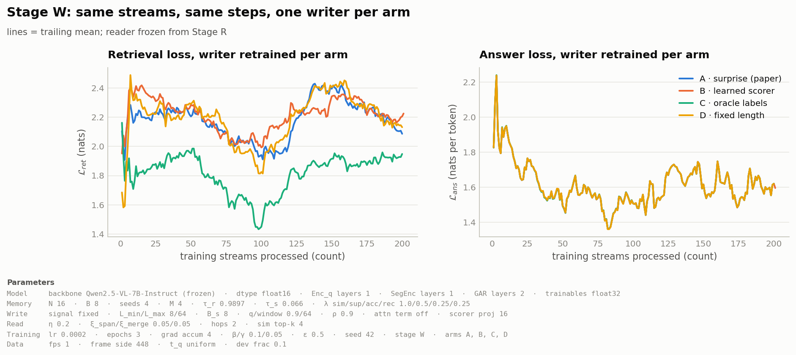
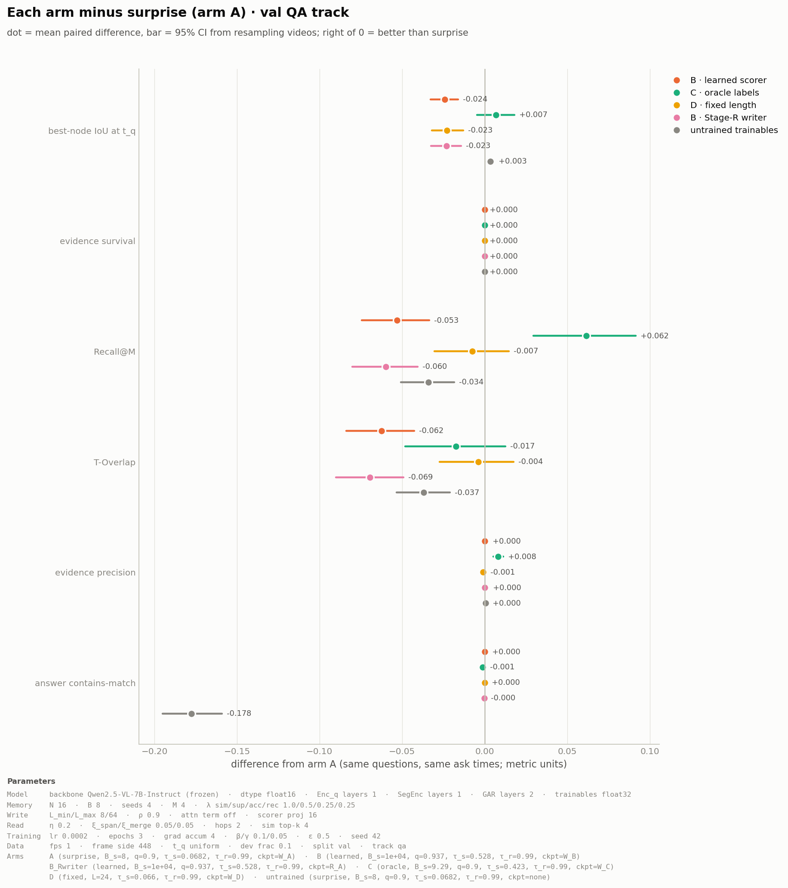

# What to Remember from a Long Video? SelectStream-lite on Ego4D NLQ and QaEgo4D

Team LMAAA: Amritha Vinod (2023101075), Dedeepya (2023101128), Keerthana Korlapati (2023101121), Sanjana Sheela (2023102027)

Code: <https://github.com/amrithav27/selectstream-lite> · Checkpoints and outputs: <https://huggingface.co/lma-project/selectstream-lite-ego4d>

Markdown copy of `docs/report_overleaf/report.tex` (the 8-page PDF is built from that file). "WRITE THIS" blocks are author notes, to be replaced with prose.

## Abstract

> **WRITE THIS:** Update the mid-submission abstract. Facts to carry:
> - Setting: streaming memory of fixed size, SelectStream [1] rebuilt from the paper, frozen Qwen2.5-VL-7B, Ego4D NLQ + QaEgo4D, all 1,686 annotated clips, causal.
> - Q1: learned importance score loses to surprise on *three* training seeds, both tracks: QA Recall@M -0.042 to -0.053, best IoU -0.021 to -0.024, every p_holm≤0.0014.
> - Q2: splitting at the same evidence budget lowers AllHit in all 8 cells (p_holm≤0.0005); giving each sub-question its own budget helps pairs (+0.04 to +0.06).
> - The answer step needs real visual tokens but not the right ones: wrong-window evidence (Recall@M 0.02) gives the same answers as the reader's own (0.50); so memories are compared by retrieval.
> - Statistics: 95% bootstrap CI over videos, paired permutation p, Holm-corrected.
> 

## Introduction

A wearable camera running all day produces hours of video, but a model can hold only a small, fixed amount
of it. The memory has to decide what to keep while the video is still arriving, before anyone has asked a
question. If the moment a later question needs has been dropped, or blurred into a neighbouring memory,
no later step can bring it back.

SelectStream [1] makes this decision with one number per moment, its surprise: how much the
scene just changed. Surprising moments get their own memory slot and are protected from merging. Surprise and
importance are not the same thing, though. A sudden turn of the head is surprising but rarely asked
about; putting keys in a drawer is calm, and is exactly what someone asks about later.

- **Q1 (write side).** With the same memory budget (N nodes) and the same number of segments, does a write signal learned from NLQ training questions keep more of the needed evidence than surprise? Is that evidence retrieved, and does it lead to better answers?
- **Q2 (read side).** For each video, composite questions are built from that video's own questions. Does splitting them into sub-questions, with an evidence check for each, beat a single retrieval at the same evidence budget M?

Q1 acts on the write side and Q2 on the read side, so together they form a 2×2 design
(write arm A/B × single/split retrieval).

> **WRITE THIS:** One short paragraph of contributions / findings (4 items): (1) a causal re-implementation with three
> retrieval fixes that make the paper's reader learn (Recall@M 0.33 → 0.52); (2) Q1 negative on 3 seeds;
> (3) Q2 negative at a matched budget, with the unmatched arm showing the loss is the halved budget;
> (4) evidence controls showing answers do not depend on evidence content.

## Literature Review

> **WRITE THIS:** New section (about 0.5 page). Suggested structure; check every citation's details before submitting
> (the entries were added from memory, not checked against the papers):
> - *Streaming / long-video memory for VLMs:* MovieChat [5] (merges similar adjacent frame tokens into a fixed
> long-term memory), MA-LMM [6] (memory bank compressed by merging similar features), Flash-VStream [7]
> (real-time memory for streams). All decide what to keep by feature similarity, none by what will be asked.
> - *Surprise / event segmentation as a memory signal:* SelectStream [1] (surprise-driven graph memory,
> the system we rebuild); EM-LLM [8] (surprise-based event boundaries for long LLM context).
> - *Egocentric episodic memory benchmarks:* Ego4D NLQ [2] (temporal windows), QaEgo4D [3] (written answers); NLQ grounding baselines such as VSLNet [9].
> - *Question decomposition (Q2):* least-to-most prompting [10], self-ask [11]: decomposition helps multi-step text QA; we test it for retrieval from a fixed memory.
> - Gap we address: whether a *learned, question-aware* write signal beats surprise under a matched budget, measured causally.
> 

## Dataset

*Ego4D NLQ [2] and QaEgo4D [3], all clips. QaEgo4D in brackets: linked to an NLQ question. The unannotated NLQ test split (333 clips) has no answer windows and is never used.*

| Split | Clips | Videos (= streams) | Hours | Frames (1 fps) | NLQ questions | QaEgo4D | Use |
|---|---|---|---|---|---|---|---|
| train | 1,271 | 924 | 174.3 | 627,624 | 13,846 | 10,665 (9,714) | train-fit (838 streams) + dev (participant split) |
| val | 415 | 300 | 57.6 | 207,395 | 4,552 | 3,751 (3,396) | test (reported) |

We use Ego4D NLQ because every question comes with the time window that answers it, so we can check
directly whether the memory still holds that window and whether the reader retrieved it. QaEgo4D adds a
written answer to most of the same questions. Together they let us score the memory, the retrieval and
the answer on one question, and every retrieval number is a plain overlap of time windows, with no model
acting as judge.

- Training questions: 14,797 (NLQ and QaEgo4D train combined, duplicates removed). Dev: 10% of the 301 known train participants (seed 42).
- Evaluation tracks: QA (243 streams, 3,751 questions, answer text) and NLQ (300 streams, 4,552 questions, answer windows only). They are never merged, since shared streams would couple read counts.
- Streams: median 480 s, longest 3,330 s. Each question is asked at a time drawn uniformly from the end of its answer window to the end of the stream; the model sees frame t only at step t, so evaluation is causal.
- No stage subsamples clips: all 1,686 annotated clips are cached once (one feature per frame, lossless PNG frames, cosine 0.99998 to on-the-fly features).

Ego4D records no age, gender or ethnicity of the wearers. Clips are uneven across collection sites (two sites make
up over 40% of clips) and activities (cooking on 23.7% of videos), so results may not carry over to other settings.

## Methodology

**Write side.** As each frame arrives the memory makes three decisions: whether to close the current
segment, whether a finished segment updates an existing node or becomes a new one, and, once all
N=16 nodes are full, which two nodes to merge. In SelectStream all three follow surprise, which we
measure as how much the frame features change (the paper's second, attention-based term is switched off).
In arm B a learned score takes the place of surprise in all three decisions. Arm C uses the true labels
in place of the score, as an upper bound, and arm D cuts every 24 frames. Thresholds are calibrated per arm
so every arm writes the same number of segments. The read side is the same in every arm, so any difference
between arms comes from how the memory was written.

**Q1 scorer.** A small network (18 inputs → 64 → 1) scores each frame from its surprise values and a
compressed copy of its features. A training frame counts as important if it lies inside the answer window of some
training question; the important ones are weighted up because they are rare.

**Read side.** For a question, every node gets a score; the best few are expanded to their
neighbours in the graph; a small module re-ranks them; and the top M=4 become four tokens that go into
the language model together with the current frame.

**Our changes.** Three retrieval changes are ours, not the paper's: a learned temperature on the node score,
centred segment features, and a fixed question–node similarity prior with learned biases. Without them the paper's
retrieval did not learn (retrieval loss at chance, Recall@M 0.33 after 7 GPU-hours). SelectStream has no public
code or weights, so we rebuilt it from the paper, and our numbers are not comparable with the published ones.

*Model and training setup.*

| Part | Detail |
|---|---|
| Backbone | Qwen2.5-VL-7B [4], frozen, fp16 (the cluster's GPUs have no native bf16) |
| Trainable | segment encoder, gate + write MLP, question encoder, re-ranker, evidence projection: 436.1M params, fp32 |
| Memory | N=16 nodes, 8-node search budget, 4 starting nodes, M=4 evidence tokens |
| Loss | answer loss + 0.1× retrieval loss + 0.05× sparsity loss, as in the paper |
| Stage R | reader + writer, arm A, 838 streams × 2 epochs, 419 optimiser steps |
| Stage W | reader frozen, writer retrained per arm, same 50 steps × 4 streams, same stream order |
| Q2 | T1 conjunction (k=2,3), T2 order (k=2), built from each video's own questions, windows ≥30 s apart, ≤3 per video per template; single retrieval (M), split matched (⌊ M/k⌋ each), split unmatched (M each) |

**Metrics and statistics.** Recall@M: any of the M evidence nodes overlaps the answer window. Best IoU:
the best-fitting node in memory at ask time. Precision: share of evidence time inside the window. Contains / exact:
answer text (QA only). AllHit (Q2): every sub-question's window retrieved. The stream is the resampling unit:
95% CI from 2,000 bootstrap resamples over streams, two-sided sign-flip permutation p over streams (10,000),
Holm-corrected within each (reference, metric) family. Every comparison is reported, nulls included.

## Experiment runs

All runs on 4 × RTX 2080 Ti (11 GB), the 7B model split across the four GPUs.

*Runs behind this report (run `full_v3`).*

| Run | Data | GPU time |
|---|---|---|
| Feature cache | 1,686 clips, 835,019 frames | 7.2 h |
| Scorer (Q1) | all train-fit frames, dev for early stopping | CPU |
| Stage R | 838 streams × 2 epochs | 6.9 h |
| Stage W, arms A–D, seed 42 | same streams and steps per arm | ~50 min / arm |
| Stage W, arms A, B, seeds 43, 44 | as above, only the seed changes | ~45 min / run |
| Evaluation | all val streams, both tracks, every arm and seed (18 runs) | 31–46 min / run |
| Read ablations + evidence controls | first 150 val QA streams, 2,338 questions (24 runs) | ~25 min / run |
| Memory budget N=64, 128 | all 243 val QA streams | ~40 min / run |
| Q2 | 285 NLQ / 237 QA videos, k=2,3, arms A, B | 51–77 min / run |
| Write-side grid | offline replay, val | CPU; rerun reproduced all 8,592 numbers |

> **WRITE THIS:** 2–3 sentences: what Stage R and W training show (Stage W figure); that seeds 43/44 retrain only Stage W
> (Stage R is 7 h per seed, so it and the scorer stay at seed 42); that checkpoints were verified by sha256 against the
> Hugging Face copies before evaluation.

## Ablations

### Read side

Arm A, 150 val QA streams, 2,338 questions; reference Recall@M 0.503, contains 0.225. Holm over the 23 variants.

*Read-side ablations against the full reader. "Same": share of answers identical to the reference.*

| Variant | ΔRecall@M [95% CI] (p_holm) | Δbest IoU | Same |
|---|---|---|---|
| no question prior | -0.074 [-0.136, -0.013] (0.34; raw p 0.034) | +0.003 | 99.5% |
| prior only | -0.006 [-0.024, +0.015] (1.0) | +0.001 | 99.7% |
| cosine only / no cosine / no biases | +0.011 / -0.017 / -0.006 (all 1.0) | ≤0.006 | ≥99.6% |
| no re-rank (= no graph expansion, = no GAR) | +0.038 [+0.022, +0.056] (0.003) | +0.002 | 92–99% |
| re-rank chooses 4 of 8 seeds | -0.006 [-0.019, +0.006] (1.0) | -0.000 | 99.8% |
| no open segment | -0.022 [-0.036, -0.008] (0.028) | +0.000 | 99.5% |
| reads do not mark nodes | -0.053 [-0.084, -0.026] (0.003) | +0.013 [+0.007, +0.018] (0.002) | 99.7% |
| M=1 / 2 / 8 (trained at 4) | -0.354 / -0.223 / +0.314 (all 0.002) | ≤0.004 | 76 / 86 / 88% |

Within retrieval, no single scoring term is distinguishable from the full reader after correction: removing the question
prior costs 0.074 Recall@M, but p_holm=0.34. The paper's re-rank step lowers Recall@M by 0.038, and
letting it choose 4 of 8 starting nodes does not recover it.

> **WRITE THIS:** 2 sentences on "reads do not mark nodes": read counts feed keep/evict, so reading keeps wide, often-read nodes
> (Recall@M +0.053, best IoU -0.013 with marking). Both A and B mark reads the same way, so the A/B comparison is not affected.

### Evidence controls

Same 150 streams, real frames. Retrieval is unchanged in the zero/noise rows, so only the tokens' content changes.

*What the answer step depends on. Reference: the reader's own evidence (Recall@M 0.503, contains 0.225).*

| Evidence given to the language model | Recall@M | Δcontains [95% CI] (p_holm) | Same |
|---|---|---|---|
| oracle nodes (answer window) | 0.934 | -0.000 [-0.002, +0.001] (1.0) | 99.4% |
| wrong nodes (all outside the window) | 0.022 | +0.000 [+0.000, +0.001] (1.0) | 99.4% |
| random nodes | 0.473 | -0.001 [-0.003, +0.000] (1.0) | 99.5% |
| reader's nodes, content set to zero | 0.503 | -0.126 [-0.150, -0.102] (0.002) | 0% |
| reader's nodes, content replaced by noise | 0.503 | -0.219 [-0.245, -0.192] (0.002) | 0% |
| no evidence tokens (M=0) | – | -0.091 [-0.114, -0.068] (0.002) | 0% |
| no evidence, blank frame (question only) | – | -0.098 [-0.117, -0.079] (0.002) | 0% |
| reader's nodes, blank frame | 0.503 | -0.024 [-0.039, -0.009] (0.036) | 64.5% |

*Independent replication (Dedeepya, Colab, all 243 val QA streams, 3,751 questions; `selectstream_rf_runs_full/`): paired difference against her own reference run, 95% CI from her script (resampling unit not re-checked). Ada column: 150 streams, the read-side and evidence-control tables.*

| Variant | Metric | Colab, 243 streams | Ada, 150 streams |
|---|---|---|---|
| no re-rank (coarse only) | ΔRecall@M | +0.041 [+0.027, +0.057] | +0.038 |
| re-rank chooses 4 of 8 | ΔRecall@M | -0.003 [-0.012, +0.005] | -0.006 |
| reads do not mark nodes | ΔRecall@M / Δbest IoU | -0.039 [-0.061, -0.019] / +0.010 | -0.053 / +0.013 |
| content set to zero | Δcontains | -0.113 [-0.132, -0.095] | -0.126 |
| content replaced by noise | Δcontains | -0.214 [-0.235, -0.193] | -0.219 |

> **WRITE THIS:** Interpretation paragraph (update the mid-submission E1–E4 text). Also one sentence on the replication table: every
> control replicates in direction and size on all 243 streams on different hardware. Recall@M 0.93 vs 0.50 vs 0.02 gives the
> same answers (99.4% identical), so the answer does not depend on *which* moment is retrieved; out-of-distribution
> tokens (zero, noise) are worse than no tokens; real visual tokens beat none by 0.091. One reading: the evidence tokens
> set the answer's form (short phrases vs sentences) and the language prior supplies the content ("on the table" is 30%
> of QA answers). Consequence: Q1 and Q2 are judged on retrieval metrics. These are real-frame replications of Dedeepya's
> Colab controls (blank / g-vector frames), which agree.

### Write side and memory budget

*Left: write-side ablations (offline replay, val NLQ, best-node IoU, N=16). Right: memory size at evaluation, arm A, all 243 val QA streams, paired with N=16 (trained), p_holm=0.0002 for every Δ.*

| Ablation | Result |
|---|---|
| oracle C - surprise A | +0.006 [-0.006, +0.018] |
| min segment length 8→4→2 | 0.236→0.219→0.175 |
| scorer with within-video losses | IoU -0.003 to -0.046 |
| cut by surprise, rank by scorer | +0.004 [+0.002, +0.007] |
| event-boundary cut signal | -0.003 [-0.009, +0.002] |
| B writer retrained vs Stage R writer | ΔRec. +0.007 [-0.004, +0.018] |

| N | Recall@M | best IoU |
|---|---|---|
| 16 | 0.518 | 0.192 |
| 64 | 0.409 | 0.238 |
|  | -0.109 [-0.134, -0.081] | +0.046 [+0.034, +0.057] |
| 128 | 0.395 | 0.244 |
|  | -0.123 [-0.156, -0.088] | +0.052 [+0.036, +0.069] |

Every write-side check points the same way: no version of the learned score beats surprise by a useful
margin. Retraining the writer for arm B, instead of reusing the writer trained with surprise, changes retrieval by +0.007
(interval includes zero), so B does not lose simply because its writer was trained for surprise.

> **WRITE THIS:** Budget paragraph: the mid-submission 9-stream case study now holds on all 243 streams with tests. More nodes →
> each node covers less time → best IoU rises (+0.046/+0.052) but the reader (trained at N=16) finds the window less
> often (-0.109/-0.123). The memory can hold the moment; the reader cannot pick it out. Answers unchanged (99.3%).

## Evaluations

### Q1: learned write signal

*Val, all streams, seed 42. Contains is the same for every trained arm (0.219–0.220).*

| Run | Role | QA Recall@M | QA best IoU | NLQ Recall@M | NLQ best IoU |
|---|---|---|---|---|---|
| untrained modules | baseline | 0.484 | 0.195 | – | – |
| A surprise (paper) | reference | 0.518 | 0.192 | 0.522 | 0.220 |
| B learned scorer | **Q1** | 0.465 | 0.168 | 0.473 | 0.190 |
| C oracle labels | upper bound | 0.579 | 0.199 | 0.582 | 0.229 |
| D fixed length | baseline | 0.510 | 0.169 | 0.517 | 0.200 |

*Paired differences, 95% CI over videos. B - A per Stage W seed: every p_holm≤0.0014.*

| Comparison | QA ΔRecall@M | QA Δbest IoU | NLQ ΔRecall@M | NLQ Δbest IoU |
|---|---|---|---|---|
| B - A, seed 42 | -0.053 [-0.075, -0.032] | -0.024 [-0.033, -0.016] | -0.049 [-0.069, -0.030] | -0.030 [-0.039, -0.020] |
| B - A, seed 43 | -0.042 [-0.066, -0.019] | -0.021 [-0.030, -0.012] | -0.035 [-0.057, -0.015] | -0.028 [-0.037, -0.019] |
| B - A, seed 44 | -0.044 [-0.066, -0.021] | -0.023 [-0.031, -0.016] | -0.044 [-0.066, -0.022] | -0.030 [-0.038, -0.022] |
| B - A, seed 43, Colab A100 (Keerthana, 50 streams, no CI) | -0.047 | -0.026 | -0.063 | -0.021 |
| C - A | +0.062 [+0.029, +0.094] | +0.007 [-0.005, +0.018] | +0.060 [+0.035, +0.084] | +0.009 [-0.002, +0.021] |
| D - A | -0.007 [-0.029, +0.015] | -0.023 [-0.033, -0.014] | -0.005 [-0.024, +0.014] | -0.019 [-0.028, -0.011] |
| A - untrained | +0.034 [+0.018, +0.049] | -0.003 [-0.006, -0.001] | – | – |
| A seed 43 / 44 - seed 42 | -0.001 / +0.015 | -0.001 / +0.001 | +0.001 / +0.020 | +0.000 / +0.002 |

The learned score does worse than surprise. On both tracks arm B finds the answer window less often
and its best node fits the window less tightly, and this now holds on all three Stage W seeds.
Within a single video the scorer separates answer frames from the rest about as well as surprise
does (AUC 0.549 against 0.543). Oracle labels (arm C) help the reader find a node that overlaps the window but do not
make that node fit the window more tightly. One reading is that better write labels change which node the reader lands
on more than how well the memory is cut.

> **WRITE THIS:** Seeds: the seed-to-seed spread of A (up to +0.020, significant for seed 44) is smaller than the B - A gap
> (≥0.035 in every seed), so the Q1 result is not a seed artefact. Excluding the 50 QA / 78 NLQ questions asked before
> their window ends changes no difference by more than 0.002. Training adds little: A - untrained +0.034; most of
> 0.33 → 0.52 comes from our retrieval changes.

### Q2: composite questions

*AllHit by retrieval strategy (95% CI over videos). Split, matched shares M=4 tokens across sub-questions; unmatched gives each its own 4. Δ = matched - single, every p_holm≤0.0005.*

| Arm | Track | k | single | split, matched | Δ matched - single | split, unmatched |
|---|---|---|---|---|---|---|
| A | QA | 2 | 0.167 | 0.066 | -0.101 [-0.135, -0.068] | 0.219 |
| A | QA | 3 | 0.095 | 0.005 | -0.090 [-0.116, -0.066] | 0.096 |
| A | NLQ | 2 | 0.182 | 0.077 | -0.105 [-0.133, -0.075] | 0.220 |
| A | NLQ | 3 | 0.096 | 0.008 | -0.088 [-0.116, -0.062] | 0.113 |
| B | QA | 2 | 0.140 | 0.066 | -0.073 [-0.102, -0.045] | 0.184 |
| B | QA | 3 | 0.054 | 0.006 | -0.047 [-0.068, -0.027] | 0.074 |
| B | NLQ | 2 | 0.136 | 0.061 | -0.075 [-0.101, -0.048] | 0.193 |
| B | NLQ | 3 | 0.061 | 0.003 | -0.058 [-0.080, -0.038] | 0.073 |

Splitting a composite question does not help retrieval at the same budget: AllHit drops in all eight cells. Only when
each sub-question gets its own four tokens does splitting beat a single retrieval, so the gain comes from more evidence,
not from the split.

> **WRITE THIS:** Q2 numbers to add: unmatched - single AllHit +0.039 to +0.057 for k=2 (p_holm≤0.025), not
> significant for k=3 (+0.002 to +0.021); sub-hit +0.039 to +0.064 in all 8 cells (p_holm≤0.026).
> Order questions (T2): 0.57–0.60 (chance 0.5). Split raises QA contains by +0.13 to +0.14 (p_holm≤0.0005)
> while retrieving less, which by § Evidence controls is the effect of asking one short question at a time. The evidence check
> does not filter: unsupported rate 0.72–0.76 (pairs) at every coverage. Planned model-made split and native two-hop
> questions were not run: the oracle split is the best case and already loses, and two-hop has no annotated second window.

### Qualitative examples and failure modes

Of the 826 QA questions arm A gets right, 408 had no retrieved node overlapping the answer window.

- **Answer collapse.** "On the table" is the answer to 1,118 of 3,751 QA questions (30%), whatever the evidence; "on the floor" is another 505.
- **Strict scoring.** Contains needs the reference text inside the prediction, so "on the floor" against "at the floor" scores zero.
- **Fresh evidence is harder to find.** Removing the open, not yet written segment from retrieval costs 0.022 Recall@M.
- **Wide nodes.** A node spans about 120–150 s against a 4 s answer window (evidence precision 0.03–0.05).

## Limitations

> **WRITE THIS:** Bullets to turn into prose:
> - Answers do not depend on evidence content on this backbone, so answer-level claims for Q1/Q2 cannot be tested; claims rest on retrieval.
> - Stage R and the scorer are one seed (42); only Stage W has three seeds.
> - Recall@M is lenient (any overlap; nodes ~30× wider than windows); best IoU and precision are reported next to it.
> - Read ablations change the memory slightly, because read counts feed keep/evict (§ Read side).
> - The official val split is the test set; the NLQ test split has no windows.
> - One backbone (Qwen2.5-VL-7B, fp16 on 2080 Ti); a Qwen3.5 port was planned but not run in time.
> - Not comparable with SelectStream's published numbers: rebuilt from the paper, different scale, data and training.
> - No age data in Ego4D; no claim about older users.
> 

## Conclusions

> **WRITE THIS:** One paragraph: Q1 answer (no, on 3 seeds, both tracks); Q2 answer (no at matched budget; budget, not
> decomposition, drives the unmatched gain); the evidence-content finding and what it means for memory evaluation with
> frozen VLMs; what would change it (retraining that hides the current frame so the model must use memory; a backbone whose
> answers depend on evidence). Applications sentence (wearable recall [12]) only with the no-clinical-claim caveat.

**Reproducibility.** Code, run scripts and every result file: <https://github.com/amrithav27/selectstream-lite> (branch `main`; `README.md`). Checkpoints: <https://huggingface.co/lma-project/selectstream-lite-ego4d>. All numbers: `python scripts/collect_results.py outputs/full_v3 outputs/full_v3/collected_results.json`.

## References

1. H. Ge, Y. Wang, H. Wu, Y. Cai. What Should a Streaming Video Model Remember? arXiv:2606.16353, 2026.
2. K. Grauman et al. Ego4D: Around the World in 3,000 Hours of Egocentric Video. CVPR 2022.
3. L. Bärmann, A. Waibel. Where did I leave my keys? Episodic-Memory-Based Question Answering on Egocentric Videos. CVPR Workshops 2022.
4. S. Bai et al. Qwen2.5-VL Technical Report. arXiv:2502.13923, 2025.
5. E. Song et al. MovieChat: From Dense Token to Sparse Memory for Long Video Understanding. CVPR 2024.
6. B. He et al. MA-LMM: Memory-Augmented Large Multimodal Model for Long-Term Video Understanding. CVPR 2024.
7. H. Zhang et al. Flash-VStream: Memory-Based Real-Time Understanding for Long Video Streams. arXiv:2406.08085, 2024.
8. Z. Fountas et al. Human-like Episodic Memory for Infinite Context LLMs. arXiv:2407.09450, 2024.
9. H. Zhang, A. Sun, W. Jing, J. T. Zhou. Span-based Localizing Network for Natural Language Video Localization. ACL 2020.
10. D. Zhou et al. Least-to-Most Prompting Enables Complex Reasoning in Large Language Models. ICLR 2023.
11. O. Press et al. Measuring and Narrowing the Compositionality Gap in Language Models. Findings of EMNLP 2023.
12. E. Woodberry et al. The Use of a Wearable Camera Improves Autobiographical Memory in Patients with Alzheimer's Disease. Memory, 23, 2015.